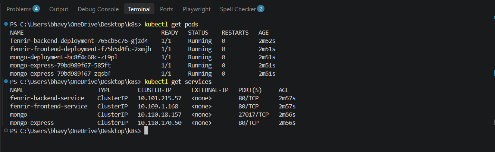
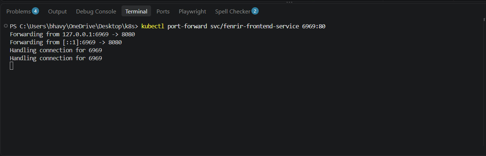
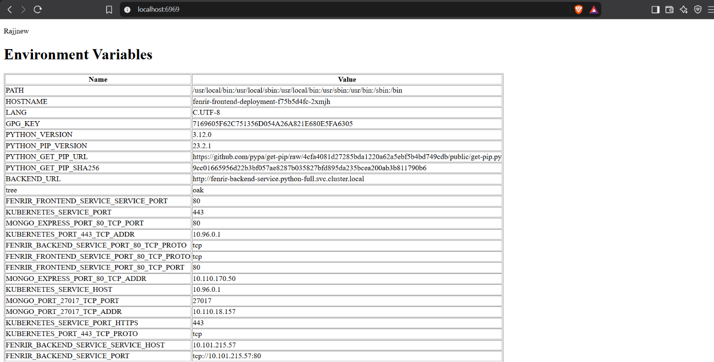
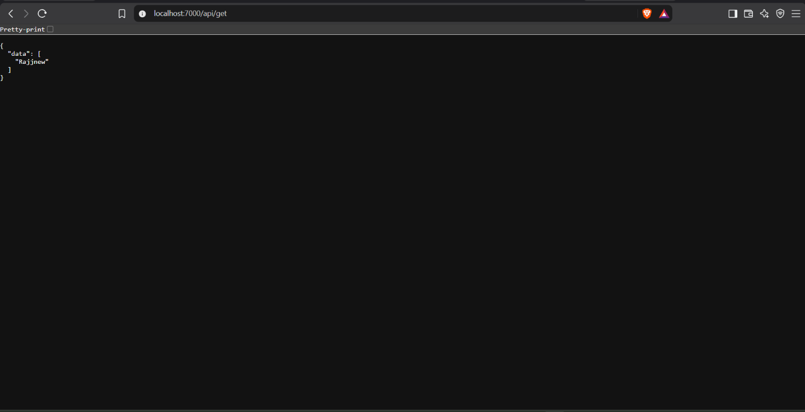
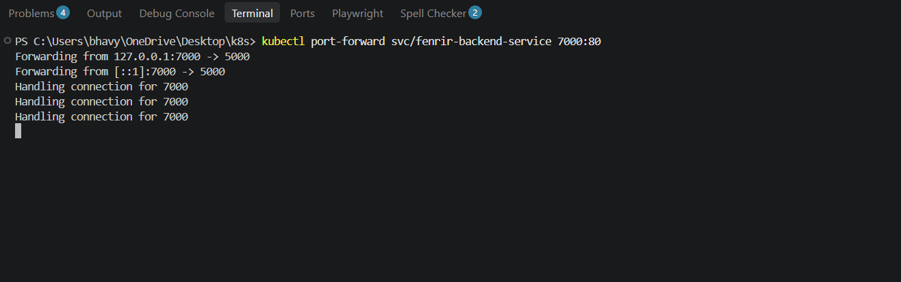

# Kubernetes Full-Stack Deployment

## DEVOPS Assignment

This project deploys a full-stack Flask application on a local Kubernetes cluster using Minikube. The frontend and backend run in separate containers, and MongoDB stores the application data.

The deployment was tested successfully. The captured evidence shows:

- All application and database pods in `Running` state.
- Kubernetes Services created for the frontend, backend, MongoDB, and Mongo Express.
- The frontend available through a local port-forward.
- The backend API returning stored data.
- The frontend displaying the returned data and Kubernetes environment variables.

## Project structure

```text
.
├── backend/
│   ├── app.py
│   ├── connections.py
│   ├── Dockerfile
│   └── requirements.txt
├── frontend/
│   ├── app.py
│   ├── Dockerfile
│   ├── requirements.txt
│   └── templates/
│       └── index.html
├── k8s/
│   ├── backend.yaml
│   ├── backend-service.yaml
│   ├── frontend.yaml
│   ├── frontend-service.yaml
│   ├── mongo.yaml
│   ├── mongo-service.yaml
│   ├── mongo-express.yaml
│   └── mongo-express-service.yaml
├── screenshots/
└── README.md
```

## Technologies used

- Python and Flask
- MongoDB
- Docker
- Kubernetes
- Minikube
- Kubernetes Services and Deployments

## Application architecture

```text
Browser
   │
   │ localhost:6969
   ▼
Frontend Service
   │
   │ fenrir-backend-service
   ▼
Backend Service
   │
   │ mongo
   ▼
MongoDB
```

The frontend reads the backend address from the `BACKEND_URL` environment variable. The backend reads the MongoDB address from `MONGO_HOST`. Kubernetes Service DNS names allow the containers to communicate inside the cluster.

## Docker images

The Kubernetes manifests use these Docker images:

- Backend: `docker.io/drizzy0606/assignment1:backend-v3`
- Frontend: `docker.io/drizzy0606/assignment1:frontend-v1`
- Database: `docker.io/mongo`
- Mongo Express: `docker.io/mongo-express`

If the application images need to be rebuilt, build and push them with:

```powershell
docker build -t docker.io/drizzy0606/assignment1:backend-v3 .\backend
docker build -t docker.io/drizzy0606/assignment1:frontend-v1 .\frontend
docker push docker.io/drizzy0606/assignment1:backend-v3
docker push docker.io/drizzy0606/assignment1:frontend-v1
```

## Minikube deployment

Start Minikube:

```powershell
minikube start
```

Apply the MongoDB resources first:

```powershell
kubectl apply -f .\k8s\mongo.yaml
kubectl apply -f .\k8s\mongo-service.yaml
```

Apply the backend and frontend resources:

```powershell
kubectl apply -f .\k8s\backend.yaml
kubectl apply -f .\k8s\backend-service.yaml
kubectl apply -f .\k8s\frontend.yaml
kubectl apply -f .\k8s\frontend-service.yaml
```

Optional Mongo Express resources:

```powershell
kubectl apply -f .\k8s\mongo-express.yaml
kubectl apply -f .\k8s\mongo-express-service.yaml
```

Wait for the deployments:

```powershell
kubectl rollout status deployment/mongo-deployment
kubectl rollout status deployment/fenrir-backend-deployment
kubectl rollout status deployment/fenrir-frontend-deployment
kubectl rollout status deployment/mongo-express
```

## Verification commands

Check the pods:

```powershell
kubectl get pods
```

Check the Services:

```powershell
kubectl get services
```

The successful run produced five running pods:

- `fenrir-backend-deployment`
- `fenrir-frontend-deployment`
- `mongo-deployment`
- Two `mongo-express` replicas

The successful run also produced these Services:

- `fenrir-backend-service`
- `fenrir-frontend-service`
- `mongo`
- `mongo-express`

## Accessing the application locally

In one terminal, forward the frontend Service:

```powershell
kubectl port-forward svc/fenrir-frontend-service 6969:80
```

Open [http://localhost:6969](http://localhost:6969) in a browser.

To test the backend API directly, forward the backend Service in another terminal:

```powershell
kubectl port-forward svc/fenrir-backend-service 7000:80
```

Open [http://localhost:7000/api/get](http://localhost:7000/api/get). A successful response has this format:

```json
{
  "data": [
    "Rajjnew"
  ]
}
```

## Evidence screenshots

The screenshots are included in the `screenshots/` folder so they remain part of the project and can be included in the final ZIP submission.

### Pods and Services



### Frontend port-forward



### Frontend running in the browser



### Backend API response



### Backend port-forward



## Submission checklist

- [x] Flask frontend source code included.
- [x] Flask backend source code included.
- [x] Dockerfiles included.
- [x] Kubernetes Deployment and Service manifests included.
- [x] MongoDB resources included.
- [x] Screenshots of commands and running services included.
- [ ] Add the final GitHub repository URL below before submission.
- [ ] Rename the project folder to `Kubernetes_YourName`.
- [ ] Compress the complete folder as `Kubernetes_YourName.zip`.

## GitHub repository

**Repository URL:** `Add your GitHub repository link here`

The GitHub URL should point to the repository containing the complete project source code, Kubernetes manifests, this README, and the `screenshots/` folder.

## Creating the submission ZIP

After adding the GitHub URL and renaming the folder, compress the complete project folder. The ZIP must contain the source code, Kubernetes manifests, documentation, and screenshots. Do not submit the README or screenshots as separate files.
